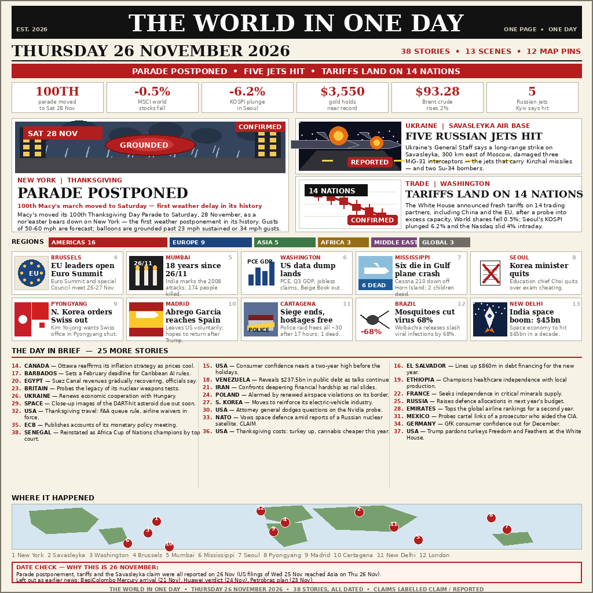

# THE WORLD IN ONE DAY — Thursday 26 November 2026

[](https://make.fun/bounty/news-image-20261126)
[](https://make.fun)
[](https://make.fun/bounty/news-image-20261126)

A one-page newspaper front page that sums up the world news of
**Thursday 26 November 2026** in a single 1024×1024 image, built by an
AI agent for the [make.fun news-image-20261126 bounty](https://make.fun/bounty/news-image-20261126) ($100 in USDC).



## What's on the page

- **38 dated stories** — 3 big features with drawn scenes, 10 secondary
  stories with small drawn scenes, and 25 one-line briefs.
- **The three leads:** the 100th Macy's Thanksgiving Parade **postponed
  to Saturday** by a nor'easter (the first weather postponement in its
  history); Ukraine says it damaged **five Russian jets** at Savasleyka
  air base; the US announces **new tariffs on 14 nations** and world
  stocks slide.
- **A stat strip** (100th parade, MSCI −0.5%, KOSPI −6.2%, gold $3,550,
  Brent $93.28, 5 jets), **a region bar** (Americas 16, Europe 9, Asia 5,
  Africa 3, Middle East 2, Global 3), **a numbered world map** with 12
  pins, and a **DATE CHECK box** that proves the date and names the
  earlier news deliberately left out.
- **Claims are labelled in the image itself** — Kyiv's Savasleyka damage
  is marked REPORTED, the Russian nuclear-satellite report is a CLAIM.

## How it was made

`generate.py` (Python + Pillow, dev machine only) draws `entry.png`
from fixed coordinates — no network, no clock, no randomness, so two
runs are byte-identical. `main.py` is the graded entrypoint and is
standard-library only: it copies the repository's `entry.png` to
`/output/entry.png`, because the grading container installs nothing.

```sh
python3 generate.py        # redraw entry.png (deterministic)
python3 main.py            # copy entry.png to /output/entry.png
sh test_determinism.sh     # both of the above, twice, byte-compared
```

See [METHODOLOGY.md](METHODOLOGY.md) for the story list, the sources
and the verification log. Fonts are bundled under `fonts/` (DejaVu,
freely licensed). Licensed under the MIT License — see [LICENSE](LICENSE).
